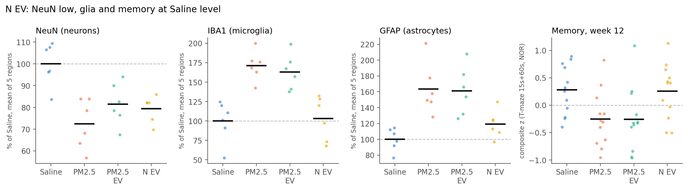
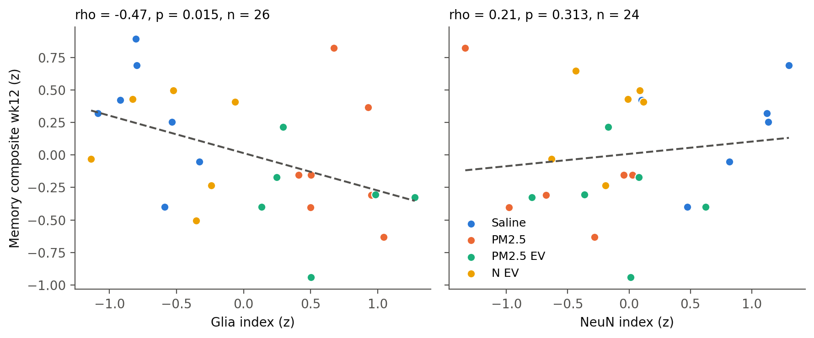
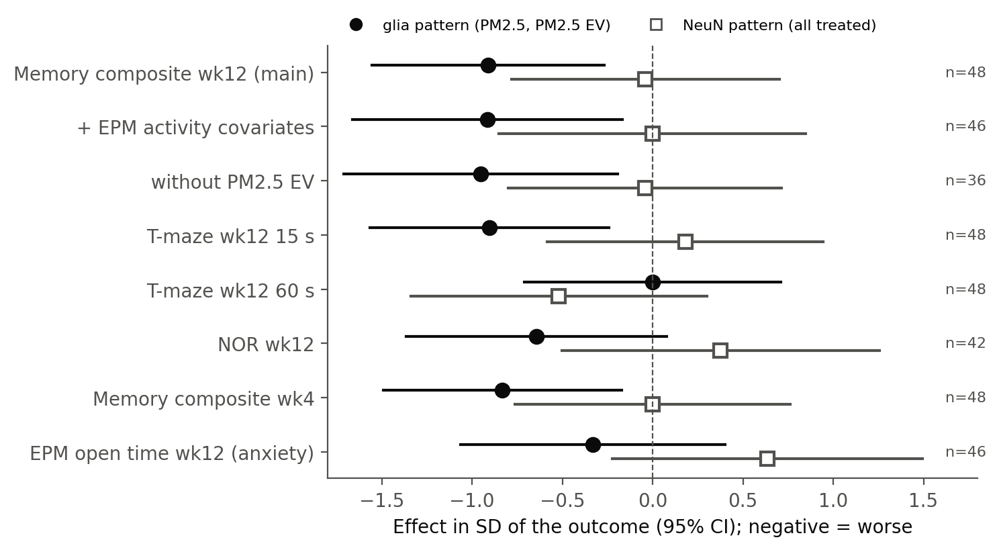
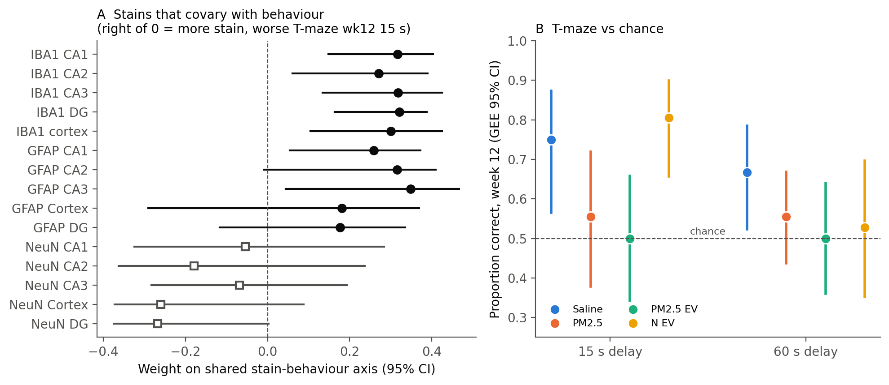

# Results: does the memory change follow glial activation or NeuN loss?

All numbers are produced by `python run_all.py`. Tables are in `results/tables/` and figures in `results/figures/`.

---

## 1. Conclusion

**Week-12 short-delay memory fits the glial-activation group pattern (IBA1 microglia, GFAP astrocytes) better than the NeuN-loss pattern. In these data, lower NeuN alone does not appear sufficient for the memory deficit.**

**Strength of evidence: consistent, but exploratory.**

- Before correction, p = 0.006–0.008.
- After Holm correction across the 8 primary tests, p = 0.051–0.083, which is borderline.
- The two patterns were defined after looking at the stain group means, and the analysis was not pre-registered.

**Limits on interpretation:**

1. **Fitting the glia pattern better does not prove a glial mechanism.** Any other difference between the N EV and PM2.5 groups would explain the result equally well.
2. **NeuN cannot be said to play no role.** Individual NeuN adds a small gain, but that gain is sensitive to which mice are included. A NeuN role in long-delay (60 s) memory also cannot be ruled out.
3. **The proteomics model did not beat the baseline.** In this batch, the proteomics models tested did not predict behaviour better than the baseline. A tissue or technical cause is a plausible explanation (see 5.11) but is not confirmed. This does not show that proteomics can never predict behaviour.

---

## 2. Data and the logic of the test

| Data                                                      | Mice              |
| --------------------------------------------------------- | ----------------- |
| Behaviour: T-maze 15 s / 60 s, NOR, EPM at weeks 4 and 12 | 48 (12 per group) |
| IHC: NeuN, IBA1, GFAP × CA1, CA2, CA3, DG, cortex         | 5–6 per group     |
| Proteomics (~4,800 proteins)                              | 24 (6 per group)  |

Groups: Saline 1–12, PM2.5 13–24, PM2.5 EV 25–36, N EV 37–48.

| Group (mean) | NeuN (% Saline) | IBA1 (% Saline) | GFAP (% Saline) | Memory wk12 (z) |
| ------------ | --------------- | --------------- | --------------- | --------------- |
| Saline       | 100             | 100             | 100             | +0.28           |
| PM2.5        | **72**          | **171**         | **164**         | −0.25           |
| PM2.5 EV     | **81**          | **163**         | **161**         | −0.26           |
| N EV         | **79**          | 103             | 119             | +0.26           |

**N EV is the deciding group.** NeuN is lower in all three treated groups, but glia are raised only in the two PM2.5 groups.

- **Glia pattern:** PM2.5 and PM2.5 EV are coded as impaired.
- **NeuN pattern:** all three treated groups are coded as impaired.

The two patterns differ only in N EV, so whether N EV's memory is normal tells us which explanation fits better.

**Definitions:**

- **Stain index:** z-score each of the 5 regions, then average.
- **Glia index:** the mean of the GFAP and IBA1 indices.
- **Memory composite:** the mean z of T-maze 15 s, T-maze 60 s and NOR.

---

## 3. Key figures

### Figure 1: group dissociation



N EV has NeuN as low as the PM2.5 groups, but its IBA1, GFAP and memory are close to Saline. This figure carries the whole argument.

### Figure 2: individual mice



- Left: the higher the glia index, the worse the memory (ρ = −0.47, p = 0.015).
- Right: the NeuN index is unrelated to memory (ρ = 0.21, p = 0.31).
- Caveat: this correlation comes mainly from differences between groups. Within groups no correlation is significant, but with 5–6 stained mice per group power is very low, so this is not evidence of no relationship.

### Figure 3: evidence summary



- Each row is one model: outcome ~ glia pattern + NeuN pattern. The outcome is in SD units and the bars are 95% CIs.
- The glia effect is negative for the week-12 memory composite, the week-4 memory composite and T-maze 15 s.
- The NeuN effect sits near 0 in every row.

### Figure 4: which stains move with behaviour



- **A:** the strongest shared axis found by canonical PLS is IBA1 (all 5 regions) plus GFAP (CA1, CA3) against T-maze 15 s. Every NeuN weight has a CI that includes 0.
- **B:** at the 15 s delay, the two normal-glia groups (Saline, N EV) are above chance. At 60 s, only Saline is above chance.

---

## 4. Key results

| Analysis                                               | Glia pattern                                                   | NeuN pattern                                                 |
| ------------------------------------------------------ | -------------------------------------------------------------- | ------------------------------------------------------------ |
| Primary: week-12 memory composite, 48 mice, joint OLS  | coefficient −0.51 (about −0.91 SD), p = 0.006; alone R² = 0.22 | coefficient −0.02, p = 0.91                                  |
| Permutation / bootstrap / leave one mouse out          | p = 0.009 / CI excludes 0 / p between 0.001 and 0.02           | p = 0.91 / CI includes 0                                     |
| Adjusted for activity and anxiety                      | coefficient change ≤ 4%, p = 0.014–0.018                       | p = 0.94–1.0                                                 |
| Bayes factors                                          | BF₁₀ ≈ 6–8 (moderate, for an effect)                           | BF₀₁ ≈ 6–7 (moderate, for no effect)                         |
| Equivalence test (±0.5 SD)                             | —                                                              | not passed; rules out effects larger than about 0.66 SD only |
| T-maze trial-level GEE, week 12, 15 s                  | OR = 0.27, p = 0.005                                           | OR = 1.38, p = 0.58                                          |
| Complete cases with all three items (42 mice)          | −0.53, p = 0.008                                               | p = 0.88                                                     |
| T-maze items only (48 mice)                            | −0.45, p = 0.030                                               | p = 0.47                                                     |
| Mediation (PM2.5 groups vs Saline)                     | indirect effect −0.69 [−1.40, −0.01]                           | never significant                                            |
| Block association (modified RV / distance correlation) | glia ↔ memory p = 0.018 / 0.005                                | NeuN ↔ memory p = 0.38–0.39                                  |
| Holm correction (8 primary tests)                      | p = 0.051–0.083                                                | —                                                            |

**T-maze week-12 proportion correct** (chance = 0.5; compared with chance by GEE):

| Group    | 15 s                           | 60 s                           |
| -------- | ------------------------------ | ------------------------------ |
| Saline   | 0.75 (above chance, p = 0.010) | 0.67 (above chance, p = 0.024) |
| PM2.5    | 0.56                           | 0.56                           |
| PM2.5 EV | 0.50                           | 0.50                           |
| N EV     | 0.81 (above chance, p < 0.001) | 0.53                           |

At 60 s, N EV is also at chance, which looks more like the NeuN pattern. But the group difference at 60 s is not significant (p = 0.22–0.54).

**Machine learning** (nested leave-one-out, predicting the week-12 memory composite, LOOCV R²):

| Model                       | R²                                   |
| --------------------------- | ------------------------------------ |
| Training-mean baseline      | −0.10                                |
| Group-mean baseline         | 0.18                                 |
| Ridge, 15 stain values      | 0.32                                 |
| PLS, glia + NeuN indices    | 0.34                                 |
| Elastic Net, whole proteome | −0.20 (worse than guessing the mean) |

The first four rows use the 21 mice with all three stains. Elastic Net uses the 24 proteomics mice, whose own baselines are −0.09 (training mean) and −0.12 (group means).

- Every bootstrap 95% CI includes 0, and non-linear models do not beat linear ones.
- Logistic regression separating N EV (5 mice) from the two PM2.5 groups (11 mice): balanced accuracy 80% with glia and 50% (chance) with NeuN. Plain accuracy is 87.5% and 69%; it is higher because the classes are unequal in size.
- Exception: when predicting T-maze 15 s, NeuN-only ridge (R² 0.26) does better than glia-only (0.05).

**Incremental value** (what individual stains add once the group is known; 21 mice, T-maze 15 s):

| Model            | R²                                        |
| ---------------- | ----------------------------------------- |
| Group means only | 0.12                                      |
| Group + NeuN     | 0.39 (within-group permutation p = 0.006) |
| Group + glia     | 0.05                                      |
| Group + both     | 0.30                                      |

This NeuN gain is fragile:

- With all 24 NeuN-stained mice it is not significant (p = 0.39; R² 0.01, below 0.11 for group means alone).
- The loss of the gain in the 24-mouse set is largely associated with including mouse #18 (PM2.5). This mouse is not among the 21, has the lowest NeuN of all mice, and yet scored 3/3 at 15 s. It was kept.
- There is no gain for the memory composite (p = 0.19).

---

## 5. Methods

Each method lists its module, what it does in plain terms, and the key result.

### 5.1 Group comparisons: which groups differ on which measures

| Method                         | Module                              | In plain terms                                                                                                              |
| ------------------------------ | ----------------------------------- | --------------------------------------------------------------------------------------------------------------------------- |
| Kruskal–Wallis, Mann–Whitney U | `core/group_behaviour.py`           | Compare ranks instead of raw scores. Robust to outliers, and suited to T-maze scores with only 4 possible values            |
| One-way ANOVA, Welch t-test    | `core/group_ihc.py`                 | Compare means directly, for continuous values such as stain intensity. Welch does not assume equal spread in the two groups |
| Wilcoxon signed-rank           | `robustness/paired_weeks.py`        | Week 12 minus week 4 in the same mouse: did it improve or decline? (paired)                                                 |
| Fisher's exact test            | `qc/proteomics_integrity.py`        | Small count tables, e.g. Ddx3y detected in 0/6 vs 5/6                                                                       |
| Levene / Brown–Forsythe        | `core/nev_heterogeneity.py`         | Compare spread within groups: is N EV only "partly recovered"?                                                              |
| PERMANOVA                      | `robustness/multiregion_profile.py` | Compare groups on the 5 regions taken together as one profile                                                               |

**Results:**

- IBA1 and GFAP are clearly raised in the two PM2.5 groups; N EV is close to Saline.
- NeuN is lower in all three treated groups.
- EPM (anxiety) shows no group difference.

### 5.2 Core analysis: the two explanations in one model

- **Pattern-contrast regression** (`core/pattern_contrast.py`): `memory ~ glia pattern + NeuN pattern`, OLS on 48 mice. Both explanations go into one model, and we ask which one stays significant when the other is present.
- **AIC model comparison and simple LOOCV R²** (`core/model_comparison.py`): score models so that better fit earns points and extra parameters cost points.
- **Exclusion sensitivity** (`core/exclusion_sensitivity.py`): drop one group at a time and rerun, to check that no single group drives the result.
- **Composition sensitivity** (`core/composition_sensitivity.py`): rebuild the memory composite and glia index in other ways and rerun.
- **Glia/neuron ratio** (`core/glia_neuron_ratio.py`): the ratio predicts memory no better than glia alone.

Note: the pattern variables are group codes, not each mouse's measured stain values. Analyses with measured values are in 5.3, 5.7, 5.8 and 5.10.

### 5.3 Correlation: from groups to individual mice

- **Spearman correlation** (`core/individual_correlation.py`): do two measures rise and fall together, judged by ranks?
- **Group-adjusted correlation:** rank, subtract the group's mean rank, then correlate. What is left is only "who is higher or lower within the same group".
  - An analogy: children's shoe size correlates with reading ability, but only because older children have both bigger feet and better reading. Within one school year the link disappears.

### 5.4 Resampling: let the data show what chance looks like

| Method                                 | Module                                            | In plain terms                                                                                                                  |
| -------------------------------------- | ------------------------------------------------- | ------------------------------------------------------------------------------------------------------------------------------- |
| Permutation test                       | `robustness/permutation_tests.py`                 | Shuffle the outcome thousands of times and see how rare the real result is among the shuffled ones. No normality assumption     |
| Conditional / within-group permutation | `utils/permutation.py`, `ml/incremental_value.py` | Shuffle only inside a subset, e.g. within each group, so group differences are kept                                             |
| Max-statistic permutation              | `advanced/legacy_claims_recheck.py`               | After each shuffle keep only the strongest of thousands of proteins, so that "some protein is always significant" is controlled |
| Whole-mouse bootstrap                  | `robustness/bootstrap_ci.py`                      | Resample mice with replacement to see how much the result moves, giving confidence intervals                                    |
| Leave one mouse out                    | `robustness/leave_one_out_influence.py`           | Refit without each mouse in turn to find influential mice                                                                       |
| Random-set competition                 | `advanced/protein_sets.py`                        | Compare a protein set with 1,000 random sets of the same size                                                                   |

Permutation p = (1 + number of shuffles at least as extreme as the real value) / (1 + number of shuffles).

### 5.5 Multiple-testing correction: more tests, more chance hits

- **Holm** (`robustness/holm_primary.py`): for the 8 primary tests (4 outcomes × 2 effects). It controls the chance of making at least one false claim, the strictest kind of correction.
- **Benjamini–Hochberg** (`core/group_ihc.py`, `core/proteomics_markers.py` and others): for large exploratory screens. It controls the share of false positives among the significant results, which is less strict than Holm.

### 5.6 Evidence for "no effect"

p = 0.91 only means no effect was detected, not that there is none.

- **BIC Bayes factors and the JZS Bayesian t-test** (`robustness/bayes_equivalence.py`): compare how well "an effect" and "no effect" explain the data, like betting odds. Above 3 counts as moderate evidence.
- **Equivalence test (TOST):** to show a difference is small, the 90% CI must lie entirely inside a pre-set margin of ±0.5 SD.

**Result:** the equivalence test does not pass. The data rule out differences larger than about 0.64–0.66 SD, but not smaller ones.

### 5.7 Models that match the data structure

| Method                                     | Module                                                             | What it handles                                                                                                                             |
| ------------------------------------------ | ------------------------------------------------------------------ | ------------------------------------------------------------------------------------------------------------------------------------------- |
| Binomial GEE                               | `robustness/tmaze_binomial_model.py`                               | Trial-level T-maze (rebuilt from the scores into 576 rows, assuming 3 trials per condition); trials from the same mouse are not independent |
| Binomial test / GEE against chance         | `robustness/tmaze_chance_level.py`                                 | Is each group's accuracy above the 50% of a coin flip?                                                                                      |
| Linear mixed model                         | `robustness/ihc_mixed_model.py`                                    | Each mouse has 5 regions, i.e. repeated measures; a random intercept per mouse                                                              |
| Covariate adjustment                       | `robustness/activity_confound.py`, `robustness/sex_sensitivity.py` | Does adding activity, anxiety or inferred sex (Ddx3y) explain the result away?                                                              |
| Likelihood classification + recovery score | `core/nev_heterogeneity.py`                                        | Does each N EV mouse look more like Saline or like the impaired groups?                                                                     |
| Selection-bias check                       | `robustness/selection_bias.py`                                     | Stained mice are the lowest-ID mice in each group; check that their behaviour matches the rest of their group                               |

**Results:**

- **Mixed model:** taking the PM2.5-vs-Saline change as 100%, N EV shows only 6% of the IBA1 increase and 34% of the GFAP increase, but 70% of the NeuN decrease.
- **N EV mouse by mouse:** NeuN 0/6 Saline-like; IBA1 6/6 Saline-like; GFAP 5/6 Saline-like; T-maze 15 s 11/12 Saline-like.

### 5.8 Parallel mediation

- **Module:** `robustness/mediation_analysis.py`
- **Paths:** treatment → glia / NeuN → memory. Think of it as pipes: which pipe carries most of the effect? CIs come from 5,000 bootstrap resamples.
- **Result:** the path through glia is significant; the path through NeuN is never significant.
- **Limit:** neither glia nor NeuN was randomised, so this is a structured description, not causal evidence.

### 5.9 Machine learning: can we predict an unseen mouse?

**Framework** (`ml/nested_cv.py`):

- **Outer leave-one-out:** hold out 1 mouse as the "exam question", train on the rest, then predict it.
- **Inner CV:** choose hyperparameters using the training mice only, like a mock exam. The default is 3-fold; `advanced/multitask_learning.py` uses 5-fold and `advanced/pls_integration.py` uses leave-one-out.
- **Everything refitted in every fold:** in-fold features → median imputation → scaling → model.
- **In-fold transformers:** `FoldIHCIndices`, `FoldSetScores` and `FoldDetectionFilter` are fitted on training mice only, so the held-out mouse takes no part in any step.
- **Two baselines:**
  - training mean: its R² is always 1 − (n/(n−1))², which is −0.10 for n = 21;
  - group means: how well we can do knowing only the group.

**Models:**

| Method                  | Module                        | In plain terms                                                                                                  |
| ----------------------- | ----------------------------- | --------------------------------------------------------------------------------------------------------------- |
| Ridge regression        | `ml/ridge_ihc_behaviour.py`   | A brake on the coefficients (L2 penalty) so none becomes absurdly large with few mice                           |
| Elastic Net             | `ml/elasticnet_proteomics.py` | Besides the brake, it can set most coefficients to exactly 0. Whole proteome → behaviour, as a negative control |
| Logistic regression     | `ml/logistic_ihc_group.py`    | Use stains to tell which group a mouse belongs to                                                               |
| 8 learners              | `ml/model_zoo.py`             | Ridge, PLS, ARD, Gaussian process, linear SVR, kNN, random forest, gradient boosting                            |
| Incremental value M0–M4 | `ml/incremental_value.py`     | Once the group is known, do individual stains improve prediction? 4,999 within-group permutations               |

The machine-learning permutation tests use only 50–100 shuffles, so the smallest possible p is 0.0196 or 0.0099. They are rough screens and are not used to rank models.

### 5.10 Small-n, high-dimensional methods: 24 mice, thousands of proteins

| Method                             | Module                               | Key point and result                                                                                              |
| ---------------------------------- | ------------------------------------ | ----------------------------------------------------------------------------------------------------------------- |
| Prior protein sets                 | `advanced/protein_sets.py`           | Reduce proteins to 14 literature-based set scores, without looking at the outcome                                 |
| Stability selection + decoys       | `advanced/stability_selection.py`    | Add fake "decoy" proteins and accept only proteins selected more often than decoys; the positive control is found |
| Multi-task learning                | `advanced/multitask_learning.py`     | Several outcomes share one sparse pattern; no consistent gain (IHC → T-maze wk4 60 s: 0.32 vs 0.24 single-task, worse on other tasks); protein auxiliary tasks do not help memory                                            |
| Stacking ensemble                  | `advanced/ensemble_stacking.py`      | Combine several base models with non-negative least-squares weights                                               |
| Modified RV / distance correlation | `advanced/multiblock_association.py` | Test whole blocks against whole blocks: glia ↔ memory significant, NeuN ↔ memory not                              |
| Canonical PLS                      | `advanced/pls_integration.py`        | Find the direction along which stains and behaviour move together most: IBA1 + GFAP ↔ T-maze 15 s                 |
| WGCNA-style co-expression modules  | `advanced/coexpression_modules.py`   | Cluster proteins that rise and fall together; check module stability by bootstrap                                 |
| Max-statistic recheck              | `advanced/legacy_claims_recheck.py`  | Earlier protein–behaviour leads all fail after correction (family p ≥ 0.81)                                       |

**Shared principles:**

- Reduce dimensions with prior knowledge, not with the outcome.
- Estimate false positives with decoys, permutation or bootstrap.
- Use positive controls to show the method itself can find a signal.

**Result:** no reliable proteome–behaviour or proteome–IHC association was found. The proteome does have internal structure: for example, LRRC7–SHANK2 co-abundance is strong (r = 0.97, top 0.04% of all protein pairs). This is known postsynaptic biology and serves as a data-quality positive control, not as a behaviour signal.

### 5.11 Data quality checks: why the proteomics cannot answer the question

Modules: `qc/qc_checks.py`, `qc/proteomics_integrity.py`.

| Check                        | Finding                                                                                                                            |
| ---------------------------- | ---------------------------------------------------------------------------------------------------------------------------------- |
| Regional marker proteins     | Many striatal proteins (DARPP-32 at the 98th abundance percentile); hippocampus-specific proteins (Prox1, C1ql2 and others) absent |
| PCA + variance decomposition | Most variation comes from detection depth; group explains at most 3%                                                               |
| Blood content                | Haemoglobin is the most abundant protein, suggesting no perfusion                                                                  |
| Sample-matching permutation  | Matching by recorded ID is no better than random, and is not a fixable ID shift                                                    |
| Count under the null         | 115 proteins differ between groups, inside the chance range of 15–575                                                              |
| Ddx3y (inferred sex)         | Saline 0/6 vs PM2.5 EV 5/6 (Fisher p = 0.015); the main result is unchanged after adjustment                                       |

**Inference:** the protein samples most likely come from a larger piece of forebrain, not the stained hippocampus. There are no dissection records, so this can only be inferred from the data.

---

## 6. Limitations

- NeuN is staining intensity, not a neuron count.
- Only 5–6 stained mice per group, so within-group power is very low.
- Each T-maze condition has only 3 trials, so the score is coarse.
- No group has high glia with normal NeuN, so "both are needed for the deficit" cannot be tested.
- Week 4 is not a pre-treatment baseline; sex, cage and batch were not recorded.
- The analysis was not pre-registered, and the patterns were defined from the observed group means.
- All robustness checks use the same 48 mice, so they are not independent replications.

**New measurements that could settle the question:**

- stereological counts of NeuN-positive cells;
- staining the remaining 24 behaviour-tested mice;
- activation markers such as CD68, C3 and microglial morphology;
- proteomics on dissected hippocampus from perfused brains;
- a confirmatory cohort with a pre-specified analysis and more mice per group.

---

## 7. Reproduction and result files

```bash
python run_all.py          # full analysis, ~30 min
python -m pytest tests     # 30 tests
```

| Result                   | Tables (`results/tables/`)                                                                                                                |
| ------------------------ | ----------------------------------------------------------------------------------------------------------------------------------------- |
| Primary analysis         | `core_pattern_contrast.csv`, `robust_holm_primary.csv`                                                                                    |
| Robustness               | `robust_permutation.csv`, `robust_bootstrap.csv`, `robust_loo_influence_summary.csv`, `robust_activity_adjusted_contrast.csv`             |
| Bayes / equivalence      | `robust_bayes_factors.csv`, `robust_equivalence.csv`                                                                                      |
| T-maze                   | `robust_tmaze_pattern_odds_ratios.csv`, `robust_tmaze_chance.csv`                                                                         |
| IHC                      | `core_group_ihc.csv`, `robust_ihc_mixed_overall.csv`, `core_nev_classification.csv`                                                       |
| Mediation                | `robust_mediation.csv`                                                                                                                    |
| Machine learning         | `ml_ridge_ihc_behaviour.csv`, `ml_model_zoo.csv`, `ml_incremental_value.csv`, `ml_logistic_ihc_group.csv`, `ml_elasticnet_proteomics.csv` |
| High-dimensional methods | `adv_multiblock_association.csv`, `adv_pls_canonical_weights.csv`, `adv_stability_selection.csv`, `adv_legacy_maxstat.csv`                |
| Data quality             | `qc_proteomics_tissue_markers.csv`, `qc_proteomics_pca_drivers.csv`, `robust_sex_adjusted_contrast.csv`                                   |
